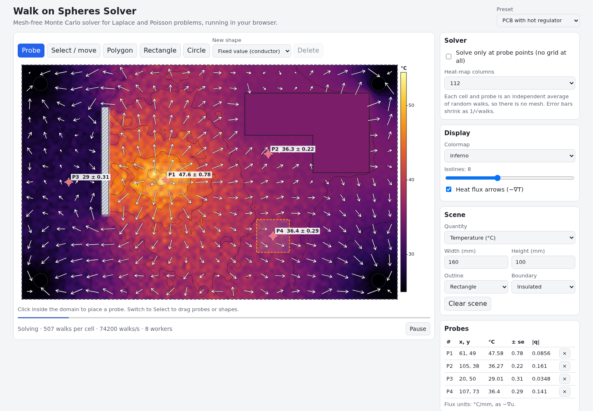

# Walk on Spheres Solver

Draw a 2D domain with conductors, insulated walls and heat sources, and solve for temperature or voltage without ever building a mesh. The solver is a Monte Carlo "walk on spheres" / "walk on stars" estimator that runs in parallel Web Workers and refines a heat map progressively, with a standard error on every probe.

**Try it: [hermes98761234.github.io/walk-on-spheres-solver](https://hermes98761234.github.io/walk-on-spheres-solver/)**

[](https://github.com/hermes98761234/walk-on-spheres-solver/actions/workflows/deploy.yml)



## Features

- **Domain editor.** Draw polygons, rectangles and circles, then set each one to a fixed value (a conductor or a clamped temperature), an insulated wall, or a source region (heat dissipation, charge density). Move shapes, edit numbers, choose a rectangular or circular outline.
- **Mixed boundaries.** Dirichlet (fixed value) and homogeneous Neumann (insulated) boundaries, the latter with walk on stars.
- **Poisson source term** for chips that dissipate heat, solving -∇²u = f.
- **Progressive heat map** with a colormap legend, isolines and heat-flux or electric-field arrows from a gradient estimator, all computed from the same random walks.
- **Probes.** Click to get a value ± standard error, plus flux. A "solve only at probe points" mode skips the grid entirely, which is the big advantage of a mesh-free method.
- **Presets:** PCB with a hot regulator and copper pours, electrode pair, coaxial cross-section (compared with the analytic solution in the probe table), heat-sink fins, and a maze.
- **Exports:** PNG of the plot and CSV of the probe values. Inputs are remembered in the browser. Light and dark themes.
- **Nothing to install.** Everything runs locally, one worker per CPU thread.

## How it works

For a harmonic function the value at the centre of a disk equals its average on the circle. Walk on spheres turns that into an estimator: from a point x, find the distance R to the nearest fixed boundary (closest-point query on a BVH over the boundary segments), jump to a uniformly random point on the circle of radius R around x, and repeat. Within a small epsilon shell of the boundary the walk stops and returns the boundary value. The average over many walks is u(x), with an error that falls as 1/√N and does not depend on how complicated the geometry is.

- **Source term.** For -∇²u = f, every step also adds the integral of f against the disk's Green's function G = ln(R/ρ)/2π, estimated with one random point in the disk.
- **Insulated boundaries (walk on stars).** The ball around x is cut off by the first insulated wall along each ray, which makes the region star-shaped. With the same Green's function the boundary kernel is dθ/2π on both the arc and the visible walls, so the next point is simply the end of a random ray. Walls reflect the walk, and from a wall point directions are sampled in the half plane.
- **Gradients.** ∇u(x) = (1/R) E[n (u(x+Rn) - u(x-Rn))] with independent walks from the antipodal pair, plus a Green's function term for sources. The arrows show -∇u.
- **Error bars.** Each point keeps running sums of the samples; the standard error is computed from them.

References: M. E. Muller, "Some continuous Monte Carlo methods for the Dirichlet problem", 1956. R. Sawhney and K. Crane, "Monte Carlo Geometry Processing: A Grid-Free Approach to PDE-Based Methods on Volumetric Domains", ACM Trans. Graph. (SIGGRAPH) 2020. R. Sawhney, B. Miller, I. Gkioulekas, K. Crane, "Walk on Stars: A Grid-Free Monte Carlo Method for PDEs with Neumann Boundary Conditions", SIGGRAPH 2023.

Tests check the solver against known solutions: u = x on a disk, -∇²u = 1 on a disk (u = (1 - r²)/4), the coaxial cable V(r) = V0 ln(b/r)/ln(b/a), a 1D channel with insulated sides for walk on stars, the gradient estimator, and the BVH against brute force.

Limitations: circles are polygons with 128 sides; overlapping shapes of different values are not resolved; the Neumann condition is homogeneous (no flux); the epsilon shell adds a bias of order epsilon times the local gradient.

## Quick start

You need [Node.js](https://nodejs.org/) 22.

```bash
git clone https://github.com/hermes98761234/walk-on-spheres-solver.git
cd walk-on-spheres-solver
npm install
npm run dev       # http://localhost:5173
npm test          # solver, BVH and scene tests
npm run build     # static site in dist/
```

## License

MIT
